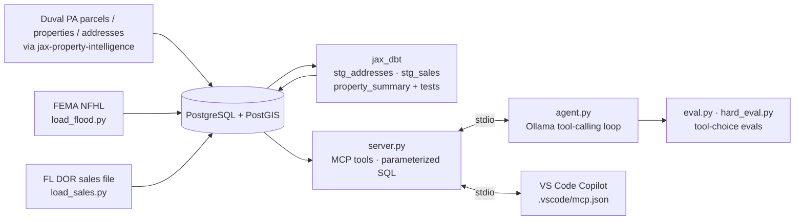
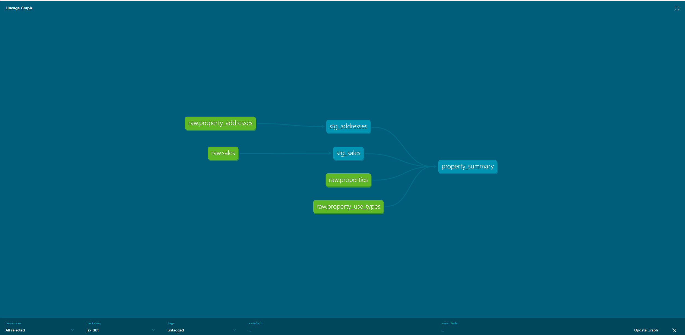

# Jax Property MCP

**Ask plain-English questions about Jacksonville property, flood risk and sales &mdash; answered by a local AI agent through tested MCP tools over PostGIS.**

<p>
  <a href="LICENSE"></a>
  
  
  
  
  
</p>

An MCP server and AI agent for Jacksonville (Duval County) property data, from 405k assessor records in PostGIS.

## What it does

- `search_properties`: properties in a ZIP within a value range (optionally by home type)
- `property_details`: full assessor record for one parcel
- `sale_history`: recorded sales for one parcel
- `recent_sales`: recent sales in a ZIP, qualified (arm's-length) only by default
- `zip_stats`: count, median, average and max value for a ZIP
- `flood_risk(strap)`: FEMA flood zones touching a parcel, whether each one is high-risk (SFHA), and what percent of the lot it covers. Data comes from FEMA's National Flood Hazard Layer, loaded by `load_flood.py` with completeness and geometry-repair checks (12,288 of 12,288 zones loaded, 0 lost).

## Architecture



## AI / agent angle

`agent.py` connects to the server over stdio and runs a tool-calling loop with a local model on Ollama (default `qwen3-coder:30b`, override with `AGENT_MODEL`), at no API cost. The same server also works in VS Code Copilot through `.vscode/mcp.json`. `eval.py` and `hard_eval.py` check that each model picks the right tool &mdash; and declines out-of-scope questions.

**Lesson learned:** without `zip_stats`, the agent compared ZIPs by sampling 100 high-end listings and wrongly said 32210 was pricier than 32207. With the right tool, it used medians ($231k vs $184k) and got it right in half the time. Tool design matters more than model choice.

## Quickstart (Windows)

Prerequisites: PostgreSQL + PostGIS with the parcel/property tables from [jax-property-intelligence](https://github.com/knightchrism/jax-property-intelligence), and [Ollama](https://ollama.com) with a tool-calling model pulled. Clone to a local folder such as `C:\dev\jax-property-mcp` (not OneDrive).

```powershell
cd C:\dev
git clone https://github.com/knightchrism/jax-property-mcp.git
cd jax-property-mcp
python -m venv .venv; .venv\Scripts\activate
pip install -r requirements.txt requests   # loaders also need requests
copy .env.example .env        # fill in DB_* (or set JAX_ENV_FILE to an existing .env)
python load_flood.py          # FEMA flood zones
python load_sales.py          # FL DOR sales
python clean_addresses.py     # logged address cleanup (addresses_qc)
python home_types.py          # DOR land-use → home type
python agent.py "Rank 32207, 32210 and 32205 by median value"
```

dbt models live in `jax_dbt/` (`dbt build` runs the 13 data tests; needs a `dbt-postgres` profile).

## Data Quality

Every loader keeps the raw data, builds a cleaned table, and logs exactly what changed, so no row is silently lost.

| Dataset | Result |
|---|---|
| FEMA flood zones | 12,288 of 12,288 loaded; 48 invalid shapes repaired with 0 sq ft area lost |
| FL DOR sales | 75,878 of 75,878 loaded; 99.8% matched to a parcel; 28,800 qualified market sales |
| Addresses | 10,552 exact duplicates removed (each traced in `addresses_qc`); ZIPs normalized from 413 values to 37 |
| Home types | 100% of 405k properties mapped to a type via Florida DOR land use codes |

Every load is logged so changes to GIS and property data can be reviewed and audited. See [DATA_SOURCES.md](DATA_SOURCES.md) for sources, licensing, and disclaimers.

## Data Pipeline (dbt)



Raw Duval County and Florida DOR data is cleaned in tested dbt staging models (`stg_addresses`, `stg_sales`) and joined into one row per parcel (`property_summary`, 405,722 parcels). 13 data tests run on every `dbt build`. The project lives in `jax_dbt/`.

## Tech stack

Python · PostgreSQL / PostGIS · psycopg 3 · dbt · MCP Python SDK · Ollama · VS Code Copilot (MCP)

## Disclaimer

**Demo / testing only &mdash; not authoritative.** Results are not a survey, title opinion, appraisal, official FEMA flood determination or legal determination, and data may be out of date. Verify with the Duval County Property Appraiser, FEMA and the Florida DOR before any financial, insurance or legal decision. Not affiliated with any of these agencies.

## Credits

Data: FEMA National Flood Hazard Layer (public domain), Florida Department of Revenue Sales Data File, Duval County Property Appraiser / City of Jacksonville public records, Florida DOR land use codes &mdash; details in [DATA_SOURCES.md](DATA_SOURCES.md). Software: PostgreSQL (PostgreSQL License), PostGIS (GPL-2.0), psycopg (LGPL-3.0), dbt-core (Apache-2.0), MCP Python SDK (MIT), Ollama Python client (MIT), python-dotenv (BSD-3-Clause), requests (Apache-2.0). Each keeps its own license.

## License

Code: MIT, see [LICENSE](LICENSE).
